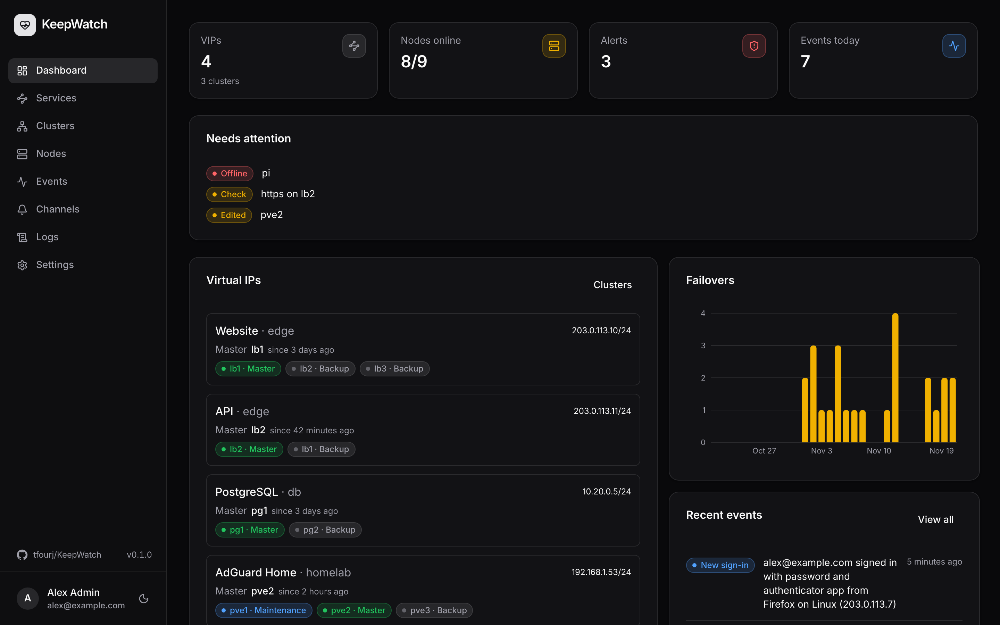
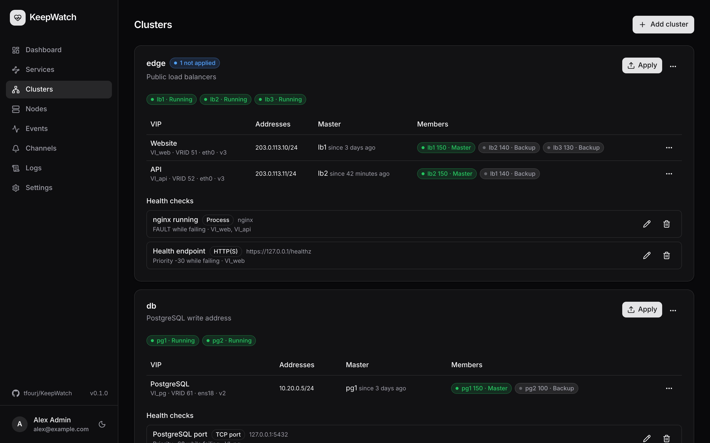
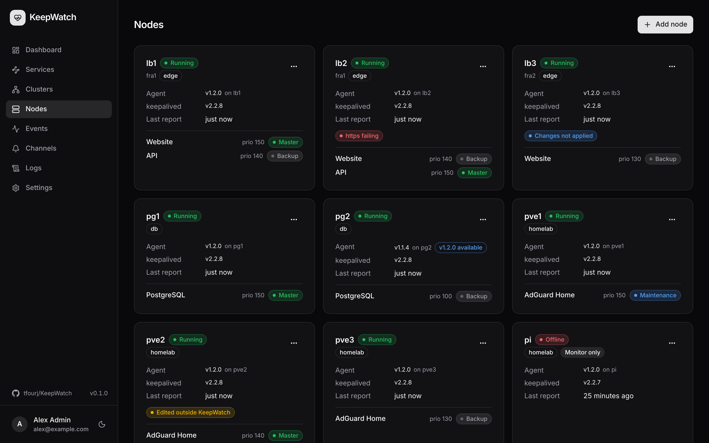
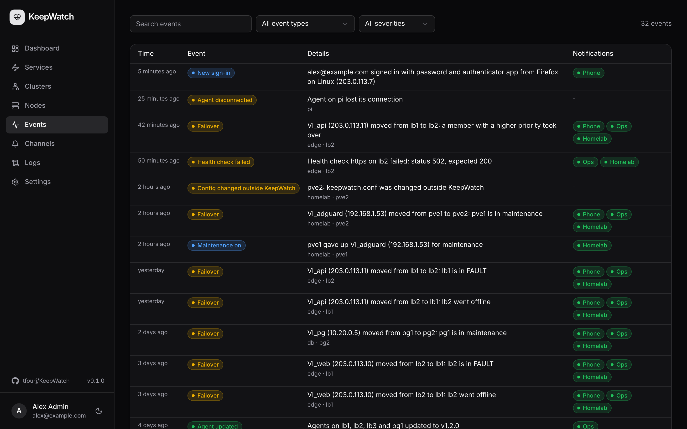
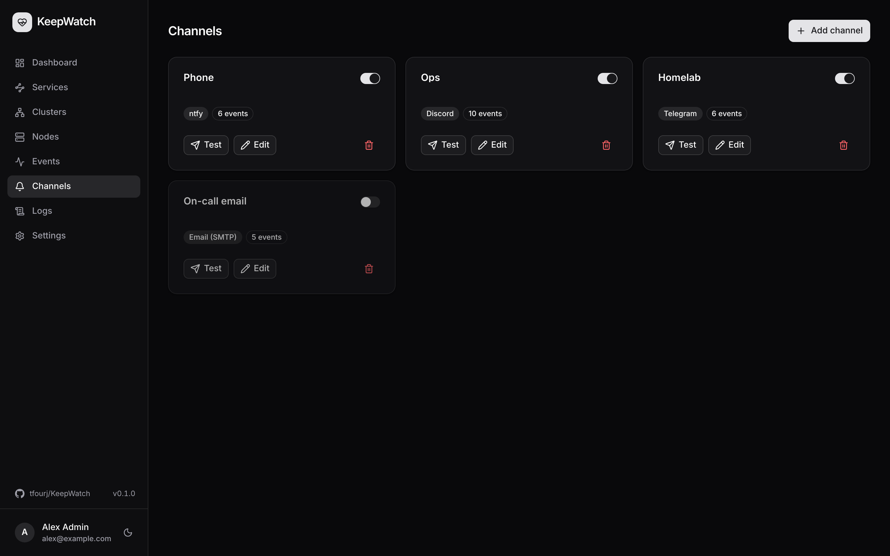

<p align="center">
  <picture>
    <source media="(prefers-color-scheme: dark)" srcset="docs/assets/logo-white.svg">
    
  </picture>
</p>

<h1 align="center">KeepWatch</h1>

<p align="center">
  Self-hosted keepalived management and monitoring.<br>
  Sets up your virtual IPs, applies the config safely and tells you when they fail over.
</p>

> [!NOTE]
> This app was developed using AI tools.

## Features

- Virtual IPs, members and priorities edited in the browser, rendered into keepalived configs on each node
- Every change shown as a diff, tested by keepalived, applied backups first and rolled back on failure
- Lightweight Linux agent with one-line install, no open ports or certificates
- Installs keepalived, or takes over or just watches an existing setup
- Health checks: TCP, HTTP(S), ping, process and your own scripts
- Alerts for failovers, split brain, no master, failing checks and configs edited by hand
- One-click failover with maintenance mode
- Signed agent commands and secrets encrypted end to end to each node
- Automatic agent updates
- Custom message templates
- Two-factor authentication and optional notifications for new sign-ins
- Dashboard with live state, failover history and event log
- Dark and light mode

## Screenshots

| Dashboard | Clusters |
| --- | --- |
|  |  |
| **Nodes** | **Events** |
|  |  |
| **Channels** | |
|  | |

## Tech Stack

Bun, Hono, SQLite (Drizzle), Better Auth, React, Tailwind CSS, Go (agent)

## Install with Docker Compose

1. Download [docker-compose.yml](docker-compose.yml).
2. Create a `.env` file next to it:

   ```bash
   # Public HTTPS URL, used for login and agent install commands
   BASE_URL=https://keepwatch.example.com

   # Generate each with: openssl rand -base64 32
   # Optional, generated into /data/secrets.json if empty. Never change ENCRYPTION_SECRET later.
   BETTER_AUTH_SECRET=
   ENCRYPTION_SECRET=

   # Optional
   PORT=4321
   # Default timezone, can be changed in Settings → General
   TZ=Europe/Berlin
   ```

3. Start it:

   ```bash
   docker compose up -d
   ```

4. Open `BASE_URL` and create your account.
5. Add a cluster in **Clusters**, then your keepalived machines in **Nodes**, and install the agent on each one.

See [docs/CONFIGURATION.md](docs/CONFIGURATION.md) for all options and [docs/BUILD.md](docs/BUILD.md) to build from source.

## Notification providers

- Discord
- Telegram
- ntfy
- Gotify
- Slack
- Pushover
- Email (SMTP)
- Webhook (JSON)

## License

[GPL-3.0](LICENSE)
